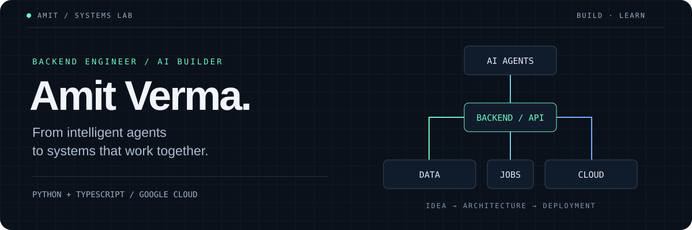

<p align="center">
  
</p>

<p align="center">
  <a href="https://github.com/amiitt001">GitHub</a> &nbsp; / &nbsp;
  <a href="https://www.linkedin.com/in/amiitt001/">LinkedIn</a> &nbsp; / &nbsp;
  <a href="mailto:amit.24gcebcs053@galgotiacollege.edu">Email me</a>
</p>

<p align="center"><b>AI agents. Thoughtful backends. Ideas shipped to the cloud.</b></p>

---

### 01 / The person behind the systems

I'm **Amit**, a Computer Science undergraduate at **Galgotias College of Engineering & Technology · Class of 2028**. I build AI-powered backend systems, intelligent agents, and cloud-native applications.

I enjoy connecting the pieces: agents that reason, APIs that coordinate, databases that remember, and infrastructure that brings it all together.

```python
amit = {
    "build_with": ["Python", "TypeScript"],
    "explore": ["Multi-agent systems", "Backend architecture", "Cloud"],
    "learn": ["System design", "Machine learning", "DSA in C++"],
    "community": ["GFG Club · Coordinator", "LOOP Tech Club · Coordinator"],
}
```

### 02 / Selected builds

#### [ADK Hiring Agent ↗](https://github.com/amiitt001/adk-hiring-agent)
**A job description in. A structured candidate evaluation out.**

A multi-agent evaluation system built with Google ADK and Gemini. Five specialized agents handle rubric creation, resume review, GitHub validation, repository review, and a final hiring recommendation.

`Python` `Google ADK` `Gemini` `GitHub API` `Docker`

```text
                         ROOT ORCHESTRATOR
                                 │
             ┌───────────────────┼───────────────────┐
             ▼                   ▼                   ▼
       Rubric Builder      Resume Reviewer     GitHub Validator
                                                     │
                                                     ▼
                                               GitHub Reviewer
                                                     │
                                                     ▼
                                             Verdict Synthesizer
```

#### [DG-AI ↗](https://github.com/amiitt001/DG-AI)
**Deadlines turned into executable plans.**

An AI productivity system that considers workload, calendar constraints, and task deadlines to detect risks, prioritize work, and generate recovery plans.

`TypeScript` `Gemini` `Prisma` `Firestore` `Docker` `Cloud Run`

#### [SkillSphere ↗](https://github.com/amiitt001/SkillSphere)
**A clearer path from current skills to future careers.**

AI-powered career guidance with resume analysis, skill-gap detection, career recommendations, and personalized learning paths.

`TypeScript` `Node.js` `Gemini` `Vertex AI` `Firestore` `Docker`

<details>
<summary><b>More from the workbench — vision, utilities & automation</b></summary>

<br />

| Project | What it does | Built with |
| :--- | :--- | :--- |
| [Dogs vs Cats Detection](https://github.com/amiitt001/Dogs-Vs-Cat-detection) | Locates animals with YOLOv8, then classifies them with a fine-tuned MobileNetV2. | Python · PyTorch · OpenCV |
| [QR Code Generator & PDF Converter](https://github.com/amiitt001/llc) | Generates QR codes and converts documents to PDF in the browser, with client-side file processing. | TypeScript · Vite · Vercel |
| [Exam Management System](https://github.com/amiitt001/Exam-Management-System) | Manages examinations, student records, and results through a structured CRUD backend. | Python · REST API · SQLite · PostgreSQL |
| [TechNova Automation](https://github.com/amiitt001/technova-n8n) | Connects APIs and webhooks into multi-step workflows that automate repetitive work. | n8n · APIs · Webhooks |

</details>

### 03 / The toolbox

| Layer | Technologies |
| :--- | :--- |
| **Languages** | Python · TypeScript · JavaScript · C++ |
| **Backend** | FastAPI · Node.js · Express |
| **Data** | PostgreSQL · Firebase · Firestore · Prisma |
| **AI & agents** | Google ADK · Gemini · Vertex AI |
| **Computer vision** | PyTorch · YOLOv8 · MobileNetV2 · OpenCV |
| **Cloud & delivery** | Google Cloud · Cloud Run · Docker · GitHub Actions · Linux |
| **Workflow** | Git · n8n |

### 04 / Currently going deeper

- **Agent architecture** — coordinating specialized agents into useful workflows.
- **Backend engineering** — FastAPI, API design, databases, and system architecture.
- **Cloud delivery** — containerized applications, Google Cloud, and CI/CD.
- **Fundamentals** — machine learning and data structures & algorithms in C++.

### 05 / Beyond the code

**Coordinator @ GFG Club & LOOP Tech Club** · Google Cloud Skills Boost · Hackathons & AI projects

I enjoy learning through building and being part of technical communities.

<details>
<summary><b>GitHub / activity & languages</b></summary>

<br />

<p align="center">
  
  
</p>

<p align="center"><sub>These cards are provided by an external service and may occasionally be unavailable.</sub></p>

</details>

---

<p align="center">
  <b>Working on something with agents, APIs, or cloud?</b><br />
  <a href="mailto:amit.24gcebcs053@galgotiacollege.edu">Let's connect.</a>
</p>

<p align="center"><sub>LEARN DEEPLY &nbsp; / &nbsp; BUILD THOUGHTFULLY &nbsp; / &nbsp; SHIP CONSISTENTLY</sub></p>
